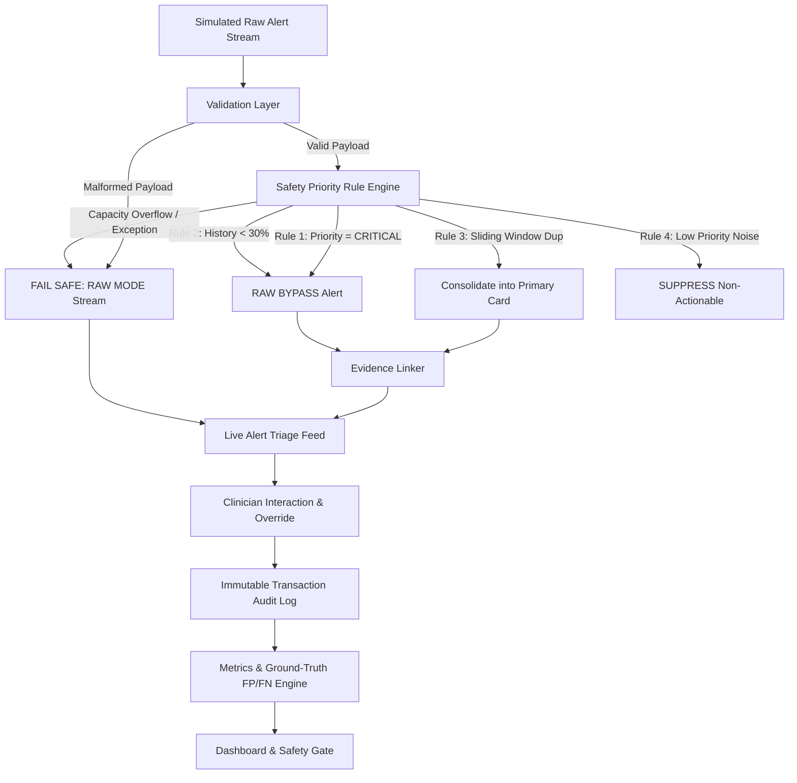

# TriagePulse — Emergency Department Alert-Fatigue Analyzer

[](file:///d:/Users/user/Desktop/New%20folder%20%282%29/TriagePulse)
[](file:///d:/Users/user/Desktop/New%20folder%20%282%29/TriagePulse)

> **DISCLAIMER**: TriagePulse is a simulated research and prototype alert-management tool. It **MUST NOT** make autonomous diagnostic decisions, treatment recommendations, medication orders, or triage level assignments. All clinical decisions remain strictly with qualified healthcare professionals.

---

## 1. Problem Statement

Emergency Departments (ED) operate in high-stress, rapid-pace environments. Clinicians receive overwhelming volumes of repetitive, low-value telemetry, lab, and workflow alarms. This leads to severe **alert fatigue**, where clinicians risk overriding, dismissing, or missing critical patient deterioration alerts.

**TriagePulse** is an alert-fatigue analyzer and safety-first deduplication engine designed to:
1. Consolidate repetitive vital sign alarms within configurable time windows.
2. Reduce non-actionable alert volume by **>= 30%**.
3. Guarantee **100% CRITICAL alert sensitivity** (CRITICAL alerts are NEVER suppressed).
4. Bypass filtering for patients with **history completeness < 30%** (unconscious/unidentified patients).
5. Provide automatic **Fail-Safe Fallback to RAW MODE** upon capacity overload or malformed data.
6. Record auditable traceable evidence and clinician override justifications.

---

## 2. Core Architecture & System Diagram



---

## 3. Technology Stack

- **Frontend Core**: React 18, Vite 5, TypeScript 5 (Strict Typing)
- **Styling & Icons**: Tailwind CSS 3, Lucide React icons
- **Data Visualization**: Recharts (Responsive Volume & Priority charts)
- **Utilities**: `clsx`, `tailwind-merge`
- **Automated Testing**: Vitest 1.3

---

## 4. Key Safety Rules

1. **Rule 1 (CRITICAL Priority)**: Alerts marked `CRITICAL` (e.g. Cardiac Arrest, Severe Hypoxia) bypass all deduplication and are **NEVER suppressed**.
2. **Rule 2 (Incomplete Patient History)**: Patients with `historyCompleteness < 30%` (e.g. unconscious trauma arrivals) bypass filtering completely.
3. **Rule 3 (Sliding-Window Deduplication)**: Repeated signals for the same patient within category-specific windows (Vital Signs: 2m, Lab: 3m, Pharmacy: 5m, Workflow: 10m) consolidate into a single primary card with duplicate counters.
4. **Rule 4 (Fail-Safe Fallback)**: Any unexpected exception, capacity breach (>100 alerts/batch), or malformed payload immediately switches the system to **RAW MODE** with a persistent top warning banner.
5. **Rule 5 (Traceable Evidence)**: Every retained alert attaches signal telemetry readings, expected reference ranges, and rule trigger rationales.

---

## 5. Sample JSON Schemas

### Alert Payload Schema
```json
{
  "id": "ALT-101",
  "patientId": "PAT-UNC-001",
  "timestamp": "2026-09-30T10:00:00.000Z",
  "category": "VITAL_SIGN",
  "priority": "CRITICAL",
  "message": "Severe Bradycardia detected: HR 34 bpm",
  "source": "Cardiac Monitor Bay 1",
  "patientStatus": "UNCONSCIOUS",
  "historyCompleteness": 0,
  "actionability": "HIGH",
  "value": 34,
  "unit": "bpm",
  "referenceRange": "60 - 100 bpm",
  "evidence": [
    {
      "sourceAlertId": "ALT-101",
      "timestamp": "2026-09-30T10:00:00.000Z",
      "signal": "Heart Rate",
      "observedValue": 34,
      "expectedRange": "60 - 100 bpm",
      "reason": "Hemodynamic collapse risk in trauma arrival",
      "confidence": 0.99
    }
  ],
  "processingDecision": {
    "decision": "RETAIN",
    "reason": "CRITICAL priority alert — zero suppression permitted by ED Safety Rule 1.",
    "ruleTriggered": "RULE_1_CRITICAL_NON_SUPPRESSION",
    "timestamp": "2026-09-30T10:00:00.120Z"
  }
}
```

---

## 6. Installation & Execution Guide

### Prerequisites
- Node.js >= 18.x
- npm >= 9.x

### Setup & Run Commands

```bash
# 1. Install dependencies
npm install

# 2. Run automated Vitest unit test suite
npm test

# 3. Start local development server
npm run dev

# 4. Production build check
npm run build
```

---

## 7. Interactive Edge Case Test Scenarios

The system includes 4 interactive edge case scenarios executable from the **Safety & Fallback Control** tab:
1. **EC1: Unconscious Patient — 0% History**: Proves zero suppression for unknown patients.
2. **EC2: Alert Flood (Capacity Exceeded)**: Proves safe fallback to RAW MODE when batch size exceeds 100.
3. **EC3: Critical Escalation Sequence**: Proves escalation from LOW -> CRITICAL preserves the CRITICAL alert card.
4. **EC4: Malformed Alert / Missing Data**: Proves payload validation failure activates fail-safe raw mode.
